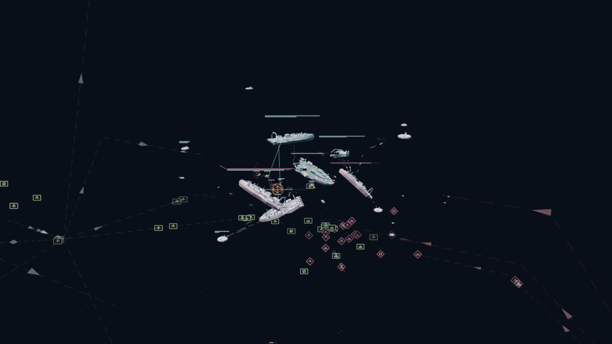

# Orbital Command

**A passthrough / VR experiment in commanding a fleet with your hands.**

What happens when a strategy game's battlefield becomes something you can pick up, shrink to a tabletop, or expand around you? Orbital Command explores that interaction in the browser using WebXR, Three.js and Meta Quest 3.

Touch a ship to select it. Place your hand in empty space to send an order there. Grab the battle with both hands to move, scale and turn it, then switch between fleet-level symbols and close-up spacecraft. The same experiment runs in immersive VR, over the headset's passthrough view, or as a desktop preview.



*Desktop preview of the experiment. This image is not a headset or passthrough capture.*

[Controls and setup](docs/quest-guide.md) · [Architecture](docs/architecture.md) · [Headset validation](docs/quest-validation.md) · [Project listing](https://walt.online/side-projects#toys)

## What the experiment explores

- **Passthrough and VR:** the same volumetric battle can float over your surroundings or fill an immersive space.
- **Direct spatial input:** fingertips and Touch controllers select ships and issue orders at an actual XYZ position, rather than on a fixed ground plane.
- **A battlefield you can hold:** one-hand dragging, two-hand scaling, horizontal rotation and a raised-wrist command menu.
- **Three scales of information:** detailed ships up close, individual NATO-inspired flags in the middle, and composition banners at strategic distance.
- **Readable strategic context:** faint 3D fronts, base-origin supply routes, travelling reinforcements and compact recent battle-pressure cues.

There is a playable local skirmish against an AI commander, plus an endless demonstration with three main battles and four smaller fights at different heights and depths. It is an interaction prototype and an ongoing toy, rather than a finished commercial game.

## Run locally

Use Node.js 22.12+ and pnpm 10.26.1 (the version pinned in `package.json`).

```sh
git clone https://github.com/waltzaround/rts-quest-3.git
cd rts-quest-3
pnpm install --frozen-lockfile
pnpm dev
```

Open **http://localhost:5174/quest.html**. Choose **Start endless demo** to explore the battle without managing production, or **Deploy fleet** for the local skirmish. The desktop preview works without a headset. The earlier planar RTS and model viewer remain at `/` and `/viewer.html` respectively.

### On Meta Quest 3

1. Enable developer mode, connect the Quest by USB, and accept USB debugging in the headset. Install Android Platform Tools on the development computer.
2. With `pnpm dev` running, run `pnpm quest:usb` in another terminal. This forwards port 5174 to the headset with `adb reverse`.
3. Open **http://localhost:5174/quest.html** in Quest Browser.
4. Choose **Enter passthrough** or **Enter VR**. Use Touch controllers, or enable the headset's hand tracking for direct fingertip interaction.

WebXR needs a secure context. USB-forwarded localhost works for development; Wi-Fi access needs HTTPS trusted by the headset. See [connection options and troubleshooting](docs/quest-guide.md#connect-meta-quest-3).

**Leave XR before refreshing.** The default Quest development mode disables automatic reloads so a source edit cannot interrupt an active immersive session. Exit VR/passthrough, refresh, then re-enter to load changes. `pnpm dev:client` retains live updates for desktop-only development.

## Core interactions

| Action | Quest | Desktop preview |
| --- | --- | --- |
| Select a unit | Touch it, then quick pinch / trigger | Click a ship |
| Issue a 3D order | Pinch / trigger at an empty point | Click / right-click; adjust depth with `[` and `]` |
| Move the battlefield | Hold a pinch or controller grip and move | Drag to orbit |
| Scale and turn | Two pinches / grips; spread or turn your hands | Wheel, zoom buttons, `+` / `-` |
| Open tools | Raise the left wrist / controller | Command deck |
| Inspect a force | Select its composition banner to highlight; select again to enter | Click its banner twice |
| Change scale preset | Wrist Overview / Individual flags / Into action | View buttons, `0` for overview, `I` for close-up |

[Full controls, combat and endless-demo guide →](docs/quest-guide.md)

## Scope and current limits

- Passthrough uses a transparent WebXR scene. It does **not** map your room, occlude ships behind furniture, or provide persistent room anchors.
- Quest mode is a local simulation. The earlier game's multiplayer backend is retained in the repository but is not connected to this spatial mode.
- Hand tracking, stereo legibility, gesture comfort and headset frame time still need physical-device acceptance testing. Desktop test results and FPS readouts do not establish those qualities.
- Browser support and tracking quality vary; use the desktop preview if an immersive session is unavailable.

The [headset checklist](docs/quest-validation.md) records the outstanding checks and the distinction between automated, desktop and physical-headset validation.

## Development

```sh
pnpm test
pnpm typecheck
pnpm build
```

The monorepo includes the WebXR/desktop client, the local 20 Hz spatial simulation, and the earlier game's worker and shared packages. See the [architecture map](docs/architecture.md) and [contribution guide](CONTRIBUTING.md).

## Provenance and licensing

This experiment continues my earlier RTS prototype and reuses its procedural ship geometry, weapon definitions and game data. The earlier [game documentation](docs/upstream-readme.md) is retained for context; its multiplayer features should not be read as features of Quest mode.

The project's source code and documentation are released under the [MIT License](LICENSE), copyright 2026 Walter Lim. Bundled runtime audio remains CC0; creators, source pages and file mappings are recorded in [audio sources](apps/client/public/audio/SOURCES.md). Dependencies and third-party assets retain their own licenses.
