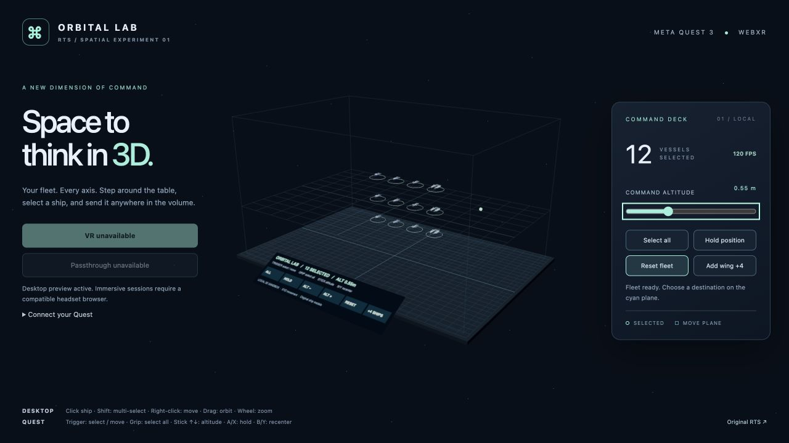

# Orbital Lab — RTS for Meta Quest 3

A private experimental continuation of [waltzaround/rts-test](https://github.com/waltzaround/rts-test), starting at `0244df9`. Reuses the original procedural fleet models in a local WebXR command table with **real XYZ movement**. Ships can climb, descend, and change depth; formation orders preserve their relative positions across all three axes.



## Start

```sh
pnpm install --frozen-lockfile
pnpm dev
```

Open **http://localhost:5174/quest.html** for the experiment. Desktop preview works without a headset. The original RTS remains at `/`, and the model viewer at `/viewer.html`. Run `pnpm dev:classic` for the original multiplayer development stack on port 5173.

## Connect Meta Quest 3

### USB — recommended for local development

1. Enable Quest developer mode, install Android Platform Tools (`adb`), and connect the headset by USB.
2. Put on the headset and accept the USB debugging prompt. `adb devices` must show it as `device`, not `unauthorized`.
3. Keep `pnpm dev` running; in another terminal run `pnpm quest:usb` (equivalent to `adb reverse tcp:5174 tcp:5174`).
4. Open **http://localhost:5174/quest.html** in **Quest Browser**. The loopback origin is a secure context for WebXR.
5. Choose **Enter VR** or **Enter passthrough** and allow the session. Use Touch controllers.

Port forwarding must be restored after disconnecting the headset or restarting ADB. For multiple devices, run `adb -s YOUR_SERIAL reverse tcp:5174 tcp:5174` manually.

### Wi-Fi / HTTPS

Use a trusted HTTPS deployment, or provide a certificate and private key valid for the hostname/IP you use on the headset:

```sh
QUEST_TLS_CERT=/absolute/path/cert.pem QUEST_TLS_KEY=/absolute/path/key.pem pnpm dev
```

Open `https://YOUR_COMPUTER:5174/quest.html` on the same network. The certificate must be trusted by the headset. A normal `http://192.168...` address will show the desktop preview but cannot enter WebXR. Keep certificates and keys outside the repository. No hosted site is deployed by this setup.

## Controls

| Action | Quest Touch controllers | Desktop |
| --- | --- | --- |
| Select vessel | Point and trigger | Click a vessel |
| Select several | Spatial ALL button or grip for whole fleet | Shift-click to toggle individual ships |
| Move selected fleet | Trigger on the cyan command plane | Right-click the plane (or click empty plane) |
| Change command altitude | Either thumbstick up/down; spatial ALT −/+ | Altitude slider or Page Up/Down |
| Hold position | A/X or spatial HOLD | Hold position button or S |
| Select fleet | Grip or spatial ALL | Select all button or A |
| Recenter table | B/Y | Orbit with drag; zoom with wheel |
| Reset / add ships | Spatial RESET / +4 SHIPS | Reset fleet / Add wing +4 |
| Leave immersive mode | Quest system controls | — |

The table appears in front of you, at a height relative to your head for seated or standing use. Recenter with B/Y if needed. No artificial camera locomotion is used. Passthrough shows the same table in your room without room scanning, occlusion, or persistent anchors.

## Experiment scope

- Original frigate, destroyer, cruiser, and carrier meshes; shared medium-detail geometry.
- Volumetric formation movement with visible paths and altitude grid.
- VR and optional passthrough, controller rays, spatial command panel, desktop orbit controls.
- Bounded at 48 vessels, no shadows/postprocessing, 0.85 XR render scale and compositor foveation.
- Independent local simulation in `apps/client/src/quest-simulation.ts`; no network or accounts required.

**This is a 3D movement and interaction sandbox, not a full volumetric combat port.** Combat, economy, collision avoidance, AI, multiplayer and hand tracking are not implemented in Quest mode. The original deterministic game remains planar and runs separately. It does not share saves or orders with this experiment.

## Validate

```sh
pnpm --filter @space-rts/client test
pnpm typecheck
pnpm build
```

See [the headset acceptance checklist](docs/quest-validation.md). Desktop tests cannot establish on-device comfort, controller tracking or frame rate; verify those on a real Quest 3 before increasing scene complexity.

The Cloudflare worker name is isolated as `rts-quest-3`, so a future explicit deployment does not target the original app. Deployment is optional and is not required for the USB workflow. The fork preserves source history; `upstream` points to the source repository.

[Original game documentation](docs/upstream-readme.md) · [Meta WebXR development](https://developers.meta.com/vr/documentation/web/webxr-first-steps/) · [Three.js WebXRManager](https://threejs.org/docs/pages/WebXRManager)
