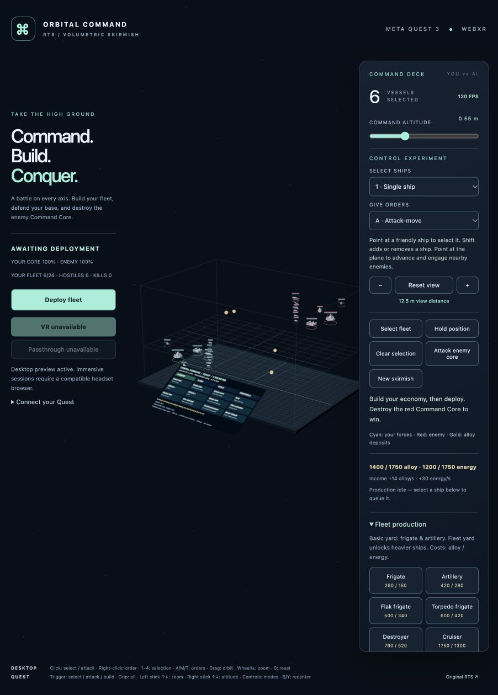

# Orbital Command — controls and development guide

A passthrough / VR interaction experiment continuing an earlier RTS prototype, starting at `0244df9`. Quest mode is a **playable local RTS skirmish against an AI commander**, using the source game's ship and structure models, hardpoints, weapon definitions, armor/shield damage profiles, resource costs and production times.

Movement, acquisition, pursuit, weapon range, projectile trajectories, collision sweeps and unit separation all use **XYZ coordinates**. Fleets fight above and below each other; altitude is part of combat, not a visual offset over a flat simulation.



## Start

```sh
pnpm install --frozen-lockfile
pnpm dev
```

Open **http://localhost:5174/quest.html** for the 3D skirmish. The same skirmish is playable on desktop without a headset. The original RTS remains at `/`, and the model viewer at `/viewer.html`. Run `pnpm dev:classic` for the original multiplayer development stack on port 5173.

`pnpm dev` uses Quest mode with automatic page reloads disabled. Source edits must not reload an active WebXR session: Quest Browser can otherwise leave a frozen image in the headset. Leave VR/passthrough, refresh the browser page to load changes, then enter again. Desktop development with `pnpm dev:client` keeps automatic updates enabled.

## Clean screenshots

For a clean desktop screenshot, open `http://localhost:5174/quest.html?photo=1`.
This starts the endless demo, frames a battle, and hides the page controls,
spatial menus and interaction cursors. Drag to orbit, wheel to zoom, and use
Space to pause for a capture. Remove `?photo=1` to restore the normal interface.

## Connect Meta Quest 3

### USB — recommended for local development

1. Enable Quest developer mode, install Android Platform Tools (`adb`), and connect the headset by USB.
2. Put on the headset and accept the USB debugging prompt. `adb devices` must show it as `device`, not `unauthorized`.
3. Keep `pnpm dev` running; in another terminal run `pnpm quest:usb` (equivalent to `adb reverse tcp:5174 tcp:5174`).
4. Open **http://localhost:5174/quest.html** in **Quest Browser**. The loopback origin is a secure context for WebXR.
5. Choose **Enter VR** or **Enter passthrough** and allow the session. Use Touch controllers.

Port forwarding must be restored after disconnecting the headset or restarting ADB. For multiple devices, run `adb -s YOUR_SERIAL reverse tcp:5174 tcp:5174` manually.

### Wi-Fi / HTTPS

Use a trusted HTTPS deployment, or provide a certificate and private key valid for the hostname/IP you use on the headset:

```sh
QUEST_TLS_CERT=/absolute/path/cert.pem QUEST_TLS_KEY=/absolute/path/key.pem pnpm dev
```

Open `https://YOUR_COMPUTER:5174/quest.html` on the same network. The certificate must be trusted by the headset. A normal `http://192.168...` address will show the desktop preview but cannot enter WebXR. Keep certificates and keys outside the repository. No hosted site is deployed by this setup.

## Play a match

1. Enter VR or passthrough if using Quest. The match starts in a planning state and will not attack you while connecting the headset.
2. Your cyan force begins with a Command Core, basic Shipyard, Extractor, Solar Array, four Frigates, one Artillery Frigate and one Destroyer. The red commander has the same starting force and resource budget.
3. Open **Fleet** on the spatial panel (or Fleet production on desktop) to queue a Frigate or Artillery Frigate. Production consumes alloy and energy and takes time; there are no free spawns.
4. Open **Build**, choose an Extractor, and point at a gold resource deposit within construction range. Solar Arrays increase energy income. Storage increases resource caps. Expand from completed friendly structures, including upward or downward.
5. Build a **Fleet yard** to unlock Flak Frigates, Torpedo Frigates, Destroyers and Cruisers. Plasma Batteries require a completed Fleet yard and sufficient storage/resources.
6. Use **Resume** on the wrist controls or give your first movement/attack order to start. The enemy builds and recruits from its own income, then sends its first assault after 25 seconds.
7. Select ships, place your controller/fingertips at the 3D destination, and trigger an empty point to issue an attack-move. Ships engage nearby enemies, then continue to their assigned goal. Switch to Move for a retreat without pursuit; ships can still fire while moving.
8. Touch a red ship or structure and trigger to focus fire. **Attack core** explicitly sends your selection after the enemy objective. Destroy the red Command Core to win; losing yours ends the match in defeat.

Production and construction can be planned while paused, but progress only while the battle runs. Queued ships launch near their producing yard and assemble there; select the new ships to issue orders. Each yard has its own queue. Destroying a yard destroys its paid orders. Cancel last production refunds only its unfinished portion.

## Controls

XR uses **direct controller/fingertip XYZ contact**, with no pointing ray, altitude setting or command plane. Touch a cyan ship and trigger/pinch to select it; touch an enemy and trigger/pinch to focus fire; trigger/pinch in empty space to send the selection to that exact 3D position. Contact tolerance is 3 cm in physical space at every zoom level, and fighter squads can be selected by touching any surviving craft. Cyan/red highlights show friendly/enemy contact; a gold cursor marks a valid empty destination and grey means outside the battle volume. Pull and scale the battle around your hands to reach distant units.

The wrist controls use direct contact too: touch a button with the other controller/index fingertip until it highlights, then press trigger/pinch. A gold contact cursor and button highlight confirm the target. The menu holds still while contacted, and activates on press rather than waiting for release. Hand joint tracking does not depend on the pointing ray. Desktop orders use a view-facing depth through the selected ships, adjusted with **[ / ]**, instead of a fixed altitude.

| Action | Quest hands / Touch controllers | Desktop |
| --- | --- | --- |
| Select / order | Touch + quick pinch/trigger; cyan selects, red attacks, empty space orders at your hand | Click ship; click/right-click destination |
| Pull battle toward you | Hold one pinch, or one controller grip, and move your hand | Drag to orbit |
| Zoom into / out of action | Hold both pinches or grips; spread hands to enlarge, bring together to shrink | Wheel or +/− |
| Audio | Wrist → Mute audio / Audio on | Audio button |
| Strategic overview | Wrist → Overview; left X toggles overview/action | Strategic view or 0 |
| Choose a fight | Select a force card to highlight; select it again to enter; wrist → Next fight | Click a card to highlight, click it again to enter; fight buttons enter directly |
| Enter battle at selected fleet | Wrist → Into action; left X toggles overview/action | Enter the action or I previews a closer view |
| Destination depth | Move controller/fingertips forward/back, up/down or sideways | [ / ] shifts target depth |
| Additional zoom | Left stick up/down | Zoom buttons |
| Show/hide command menu | Raise left wrist/controller; More tools or B/Y expands tools on your hand | Command deck |
| Select fleet / selection modes | Command menu | Select fleet / F; 1–4 selection modes |
| Hold position | A on right controller; menu → Hold | Hold or S |
| Start / pause / resume | Wrist Pause/Resume; first valid move/attack starts a fresh match | Deploy/Pause/Resume or Space; first move/attack also starts |
| Production / construction | Menu → Fleet / Build | Fleet production / Base construction |

### Spatial control experiment

Enable hand tracking on the headset and set down the Touch controllers to use bare hands. The app requests optional WebXR hand tracking; controllers remain supported when hand tracking is unavailable. Touch a ship or destination and pinch thumb/index briefly to select or issue an order. Hold a pinch for about 0.3 seconds (or move it) to grab the battle. Two pinches immediately become a zoom gesture; releasing either after a zoom does not issue an order. Grab away from wrist controls to manipulate the battle; pinches on menu controls activate those controls instead.

The battle can scale from 0.02× to 12×. Two-hand manipulation follows the moving midpoint between your hands: lift, pull or spread them together to translate and scale the battle. Turning the line between both grabbed hands rotates the battlefield horizontally around the Y axis; raising one hand never tilts or rolls it. Near-vertical hand lines temporarily suspend turning to avoid unstable heading. A 30 cm spread gives roughly 6× magnification with a short smoothing filter. One hand also drags freely in XYZ, including upward; the cuff cannot intercept its own hand. Hands closer than 6 cm rebase the gesture to avoid abrupt scaling. Left-stick zoom is faster and locks its target until you release the stick. The headset projection is unchanged. Strategic view fits a small floating battle in front of you; Enter action expands your selected fleet to 5× near eye level. You can move within the field and pull distant action toward you without moving the tracked player camera. A compact eight-button cuff appears above your raised left wrist or controller: Overview, Into action, Start/Stop demo, Select fleet, Pause/Resume, More tools, Audio and Next fight. It hides when lowered or while grabbing the battle. More tools expands the full menu above that same wrist. There is no face-following terminal. Neither room geometry nor collision with real furniture is implemented.

Single ship replaces selection; Toggle ships adds/removes one ship; Same class selects matching friendly ships; Nearby group selects a 0.35 m XYZ sphere in simulation coordinates. Desktop Shift-click adds a class or group. Attack-move engages along the route, Move travels without pursuit, and Focus fire requires an enemy target.

Orders in the initial ready state now start the battle automatically, so a valid movement order executes immediately. An explicitly paused match stays paused: both the wrist status and order feedback say to Resume. Production alone does not start the battle. Losing headset visibility or leaving XR pauses a running match.

### Fighters, bombers and effects

The basic yard produces fighters and bombers using the original prices, build times and five-unit batches. Each fighter unit is a five-craft squad with shared health; losses reduce its visible member count and active guns. Fighters and bombers make XYZ combat circuits instead of parking in range. All pending units in a production batch reserve fleet capacity.

Quest rendering now reuses the original banking fighter formations, six-sample engine wakes, weapon-head geometry and weapon colours. Torpedoes, plasma and rapid-fire tracers have distinct silhouettes/trails; destruction adds expanding shock rings. Turret projectiles and beams start at transformed barrel mouths (including alternating barrels and launcher cells). Ordinary hits use swept contact positions and small directional sparks; only destruction creates a centered blast. These remain bounded instanced effects without postprocessing. Projectile heads/trails, beams, interception lines and impact/destruction effects fade between four and eight battle metres and disappear in the force-count overview, leaving fronts, supply routes and banners prominent. Nearby portions of long beams remain visible in combat view. The demo maintains fighters and bombers on both teams.

### Capital ships and audio

Battleships have ten times a frigate's diameter, 18 original hardpoints (six railguns, two plasma, two beams and eight point-defense mounts), and their original hull/shield stats. Cruisers use 1.5× their original size with 12 hardpoints; siege capitals use 2× size with two strategic-artillery mounts. Battleships use 2.5× their source size. Hull rendering, hit volumes, production clearance and deck-mounted weapon positions share these class scales. The capital yard requires a completed fleet yard; additional storage makes the original capital production prices affordable.

Original weapon, impact, explosion and engine assets play through head-tracked spatial audio after a user interaction. Sound positions follow battlefield manipulation. Audio is muted while paused, hidden or disabled from the cuff/desktop. Gunfire is coalesced and capped at 24 transient voices plus one engine loop.

### Strategic zoom

Zooming out replaces hulls with Battlespace-inspired NATO symbols: mint friendly rectangles, pink hostile diamonds, distinct spacecraft class marks and dark fills. Selected symbols turn gold. Models give way to individual flags around 8–10.5 unscaled battle metres. A wide middle layer keeps every unit individually visible; force counts are reserved for the furthest zoom beyond 32 metres. The Individual NATO flags button opens the middle layer directly, and the wrist Controls page offers the same preset. Icons shrink moderately with distance and unhighlighted distant symbols become dimmer and less saturated. Hulls occlude badges; highlighted occluded badges retain only a faint dashed frame. Crowded labels use stable offsets capped at roughly three degrees, with a dot at the true position and a thin connector back to the badge. This presentation-only layout never moves simulation units; desktop and direct-hand hit targets follow the displayed icons. Only at top zoom beyond 32 battle metres, three or more nearby ships of the same class, side and encounter combine into a counted badge. Grouping also checks XYZ proximity and depth, so aligned but separate fleets stay distinct. Selecting a friendly group selects its members and expands their symbols; approaching expands groups below 27 metres. Overview regroups previously expanded units. Hull/shield bars appear only for selected, hovered, recently damaged or constructing units. Zooming into a fight restores its models, turrets, wakes and detailed effects; distant fights keep their icons. Models and symbols crossfade over 8–10.5 battle metres; cards crossfade over 27–32 metres. A short 120 ms exponential response smooths rapid zoom reversals and preset jumps. Picking follows the dominant representation, and fully visible force cards still suppress their individual flags. Count grouping retains hysteresis to avoid flicker. Icons remain selectable with direct XYZ contact and desktop picking. Hull geometry, turret updates, wakes and fine projectile effects are skipped at strategic distances.

The demo's Overview fits all seven fights. The three main battles each have composition cards; smaller depth skirmishes keep local symbols and top-zoom group counts. Each site has two stacked NATO-inspired force cards: mint friendly rectangles and pink hostile diamonds, with fighter/bomber/warship counts and a small Σ total tab, following the Battlespace army badge layout. A thin top strip shows remaining hull-plus-shield strength relative to the full roster. Cards use compact symbol-and-count badges with no headings or small print, fixed above each encounter in battle space. Their position and orientation do not track the viewer. They refresh at most twice per second, disappear close up, and replace the map name labels. Ship affiliation and selection rings are removed; selected friendly hull bars brighten and strategic icons turn gold instead. Touch/click a composition card once to highlight that side’s banner and outline its deployed force in gold; select the same card again to enter that fight. Selecting another card changes the highlighted force. Friendly card selection also selects its ships for orders; enemy card selection only inspects that force. Leaving overview clears the banner selection. The compact ▲/▼ cue shows the difference between the sides’ net reinforcement arrivals and unit losses over the last 20 simulation seconds, with GAIN/LOSS/EVEN labels. Units still travelling do not count as arrivals; pause freezes the window and demo restarts clear its history. Fight buttons enter directly; Next fight on the wrist cycles sites. Into action also uses an inspected unit as its focus. Overview returns to the whole map without restarting combat. The demo uses a larger volume; ordinary skirmish bounds are unchanged.

### Endless demo battle

Choose **Start endless demo** on desktop or **Start demo** on the wrist cuff. One large 3D front contains three main battles: Alpha (lower escorts), Bravo (high capital assault) and Charlie (deep siege). Each side has one rear base with a Command Core, capital shipyard and reactor. Faint dashed supply routes branch from the base to all seven fights, with directional markers and actual replacement ships travelling through space. Fifty-five ships per side start deployed and nine start outbound. Every three simulation seconds, missing roster slots launch replacements from the same rear base; ships already in transit reserve their slot. Convoys use a faster cruise speed, then resume their class's combat speed on arrival. They do not teleport into the fight.

Each side supports 64 ships: twenty-one fighter squads, fifteen bombers, nine frigates, seven destroyers, six cruisers, three siege capitals and three battleships. Alpha has 36 total ships assigned and Bravo and Charlie have 30 each. Each main battle has plasma, rail and point-defense installations on both sides at different heights; destroyed installations return on a twelve-second cycle. Two very faint blue/red territory surfaces share one field across the entire map. Fleet strength and installations shape the curved 3D boundary; the tint fades as you enter the action. Composition cards stay fixed above each battle in both position and orientation, without facing or following the viewer.

Four smaller fights add spatial depth: Crossing One bridges Alpha and Bravo, Crossing Two bridges Bravo and Charlie, Friendly High raids friendly space at height 7.7, and Hostile Low strikes enemy space at height 0.85. Each has four ships per side, its own compact XYZ combat area and real base-delivered replacements. Use Depth skirmishes on desktop or Next fight on the wrist to visit all seven. The battle volume extends to height 9.

The demo bypasses the normal economy and replaces manual orders with demo commands. Core destruction starts another round without moving or rescaling your view. Pause/Resume freezes convoys and supply markers as well as combat. Stop demo returns to a fresh, ready normal skirmish and preserves your view.

Pinch tracking quality, gesture feel, stereo readability and large-scale performance still require physical Quest acceptance testing. Desktop tests cannot establish these.

## Port boundaries

This version provides one complete **local industrial-faction skirmish** with ten trainable ship classes, seven buildable structures, base economy, per-yard production, a resource-constrained AI, selectable 3D formations, hold/move/attack-move/focus orders, shields and armor, projectile and beam weapons, torpedo interception, health/destruction feedback and terminal victory/defeat.

Shared source data governs weapons, damage profiles, health, costs, prerequisites and build times. The new local 20 Hz simulation adds 3D aiming and collision checks. Its tabletop rules use upfront costs, shield regeneration after six damage-free seconds and sphere separation. It does not run the upstream planar Box3D solver or use the original lockstep protocol. Ordinary projectiles follow their launch trajectory and can miss; fast rounds use swept collision tests. Defensive beams apply their damage immediately.

**Not yet ported:** network multiplayer/replays, fog of war, Brood/Concord factions, the full capital-ship technology tree, terrain/asteroid occlusion. The original full planar game remains separately available at `/`. Quest mode does not exchange saves/orders with it.

Budgets: 24 active or queued ships per side in normal skirmishes (64 per side in the navigation demo), 16 structures per side, 1,024 live projectiles, and bounded effects. Hulls, turrets and health bars use instanced rendering with shared geometry; no shadows or postprocessing. XR render scale remains 0.85 with compositor foveation. Physical Quest frame time must still be measured.

## Validate and extend

```sh
pnpm --filter @space-rts/client test
pnpm typecheck
pnpm build
```

- `apps/client/src/quest-combat.ts`: fixed-step combat, AI, economy, production, placement and match lifecycle.
- `apps/client/src/quest-simulation.ts`: XYZ movement and formation bounds.
- `apps/client/src/quest-battle-view.ts`: instanced models, picking proxies, projectiles, effects and health bars.
- `apps/client/src/quest.ts`: headset/desktop controls and the shared spatial command panel.
- `apps/client/src/quest-combat.test.ts`: damage, 3D range/intersection, pursuit, interception, technology, production, pause, victory and defeat scenarios.

See [the headset acceptance checklist](quest-validation.md). Desktop tests cannot establish on-device comfort, controller tracking or frame rate; complete the hardware checklist on a real Quest 3.

The Cloudflare worker name is isolated as `rts-quest-3`. No deployment is required for the USB workflow. The repository preserves the earlier prototype’s source history. The original upstream remote may require separate access; it is not needed to run this experiment.

[Original game documentation](upstream-readme.md) · [Meta WebXR development](https://developers.meta.com/vr/documentation/web/webxr-first-steps/) · [Three.js WebXRManager](https://threejs.org/docs/pages/WebXRManager)
